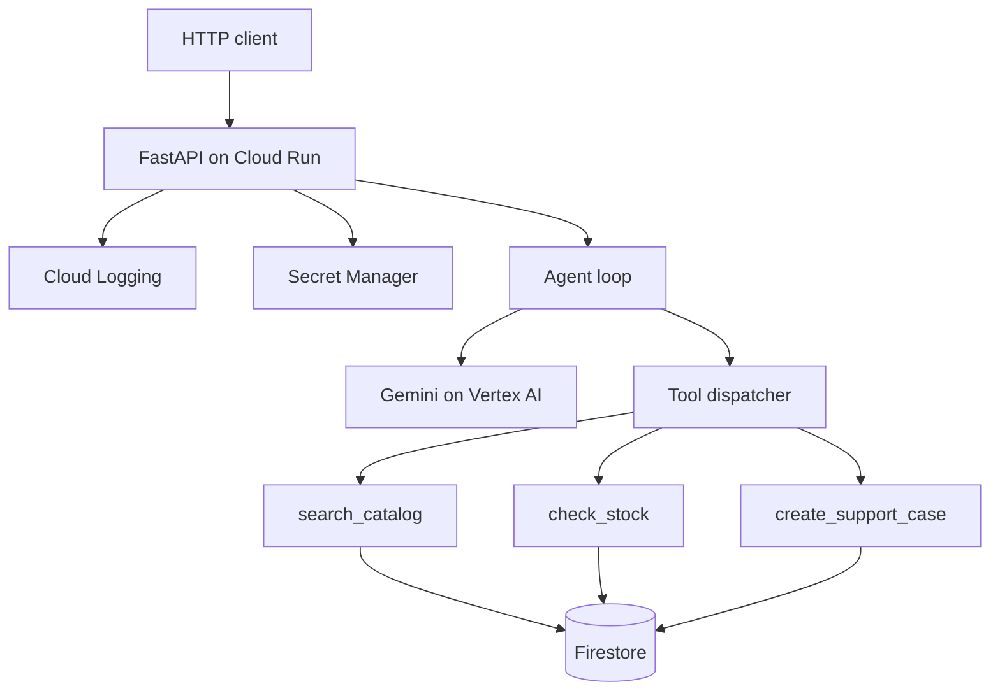

# Northline Outfitters agent

A Python support agent for a small outdoor catalog. Gemini on Vertex AI chooses when to search products, check stock, and open a support case. FastAPI serves the agent. The deploy target is Cloud Run, with the catalog and cases in Firestore.

This is a portfolio demo by Arpan Bom. The default process uses an in-memory catalog and a deterministic local router, so it runs with no Google account, API key, or hardware. Vertex AI, Firestore, Secret Manager, and Cloud Logging are wired behind those interfaces. Unit tests drive them with a scripted model client and an in-memory Firestore fake. No quality, latency, or cost numbers are published here. Measure those in your own project if you productionize it.

The model client is the [google-genai](https://googleapis.github.io/python-genai/) SDK in Vertex mode (`vertexai=True`). Automatic function calling is off. This process runs the tools and sends the results back, which is the same loop the tests exercise with a script.

## Architecture



On Cloud Run the service account can call Vertex AI, read and write Firestore, write logs, and read the system-prompt secret. Locally, `MODEL_BACKEND=local` and `STORE_BACKEND=memory` skip those clients.

Cloud Run collects stdout. The process writes one JSON object per line with a `severity` field, which Cloud Logging parses. `CLOUD_LOGGING_CLIENT=true` also attaches the Cloud Logging client library for a process that is not already captured by the platform.

## Run it

Python 3.11 or newer.

```bash
python3 -m venv .venv
source .venv/bin/activate
pip install -e ".[dev]"
uvicorn app.main:app --host 127.0.0.1 --port 8091
```

Open `http://127.0.0.1:8091/docs`, or:

```bash
curl -s http://127.0.0.1:8091/health
curl -s -X POST http://127.0.0.1:8091/v1/chat \
  -H 'content-type: application/json' \
  -d '{"message":"Is the Lumen lantern in stock?"}'
```

The local router is not a language model. It sends obvious catalog, stock, and support requests through the same three tools. A greeting returns a short help line. The seeded catalog is five products; the Trailblazer jacket (`TB-100`) is out of stock so a case can be opened:

```bash
curl -s -X POST http://127.0.0.1:8091/v1/chat \
  -H 'content-type: application/json' \
  -d '{"message":"Please open a case for ada@example.com about the Trailblazer jacket."}'
```

`POST /v1/chat` accepts an optional `session_id`. History stays in memory on that process. `GET /v1/catalog` lists the seed products.

### Vertex AI and Firestore

Set these in the environment and provide Application Default Credentials. Copy `.env.example` as a starting point. Do not commit a filled-in `.env`.

```bash
export MODEL_BACKEND=vertex
export STORE_BACKEND=firestore
export GOOGLE_CLOUD_PROJECT=your-gcp-project
export GOOGLE_CLOUD_LOCATION=us-central1
export GEMINI_MODEL=gemini-2.5-flash
export SECRET_MANAGER_ENABLED=true
```

`GEMINI_MODEL` defaults to `gemini-2.5-flash`. Point it at a Gemini model id that your Vertex project actually has enabled.

When `SECRET_MANAGER_ENABLED=true`, startup reads the latest version of secret `agent-system-prompt` (override the id with `AGENT_PROMPT_SECRET`). `AGENT_SYSTEM_PROMPT` in the environment wins and skips Secret Manager. With the flag off, the built-in prompt in `app/prompts.py` is used.

Firestore collection `products` uses the SKU as the document id:

```json
{
  "sku": "LN-220",
  "name": "Lumen Camp Lantern",
  "description": "Rechargeable lantern with a warm low mode.",
  "tags": ["light", "camp"],
  "price_cents": 6400,
  "stock": 24
}
```

The agent writes support cases to `support_cases`. Search filters the product collection in process. That matches a catalog of a few dozen rows. A larger catalog needs a search index.

## Test it

```bash
pytest
```

The suite does not call Vertex, Firestore, Secret Manager, or Cloud Logging. `tests/fakes.py` has the scripted model and the Firestore fake. GitHub Actions (`.github/workflows/ci.yml`) runs `pytest` and, in a second job with no GCP credentials, `terraform fmt -check`, `terraform init -backend=false`, and `terraform validate`.

## Container and Terraform

`Dockerfile` listens on `$PORT` (8080 by default), which is what Cloud Run sets. `cloudbuild.yaml` builds the image, pushes it to Artifact Registry, and deploys Cloud Run. `scripts/deploy.sh` submits that config. Neither file is run by tests or CI.

```bash
# requires gcloud auth and an Artifact Registry repo named "agents"
PROJECT_ID=your-gcp-project ./scripts/deploy.sh
```

Terraform in `terraform/` creates:

- a service account and the IAM roles for Vertex AI, Firestore, logging, and Secret Manager
- the default Firestore database in Native mode
- the `agent-system-prompt` secret and an initial version
- a Cloud Run service running the image you pass in

`image` and `project_id` have no defaults. Applying this creates billable Google Cloud resources.

```bash
cd terraform
terraform init
terraform plan \
  -var="project_id=your-gcp-project" \
  -var="image=us-central1-docker.pkg.dev/your-gcp-project/agents/vertex-agent:latest"
```

See `terraform/terraform.tfvars.example`. `allow_unauthenticated` defaults to false.

## Layout

| Path | Role |
| --- | --- |
| `app/main.py` | FastAPI app and backend wiring |
| `app/agent.py` | Tool-calling loop |
| `app/vertex.py` | google-genai Vertex client |
| `app/local_router.py` | Credential-free stand-in for Gemini |
| `app/tools.py` | `search_catalog`, `check_stock`, `create_support_case` |
| `app/store.py` | In-memory catalog |
| `app/firestore_store.py` | Firestore catalog |
| `app/secrets.py` | Secret Manager reader with an env override |
| `app/logging_setup.py` | JSON logs for Cloud Logging |
| `tests/` | pytest suite, fakes only |

## License

MIT. See `LICENSE`.
